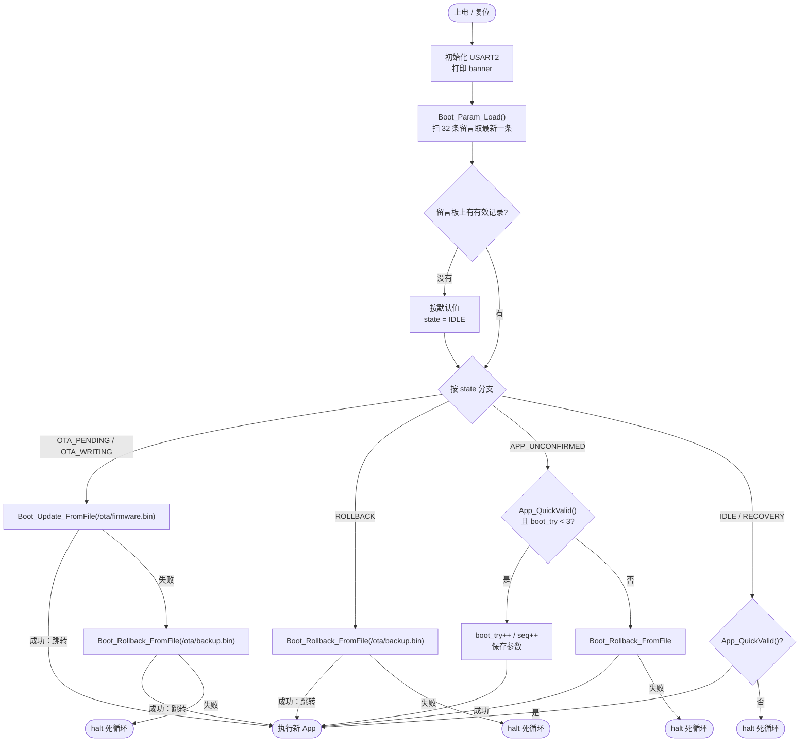
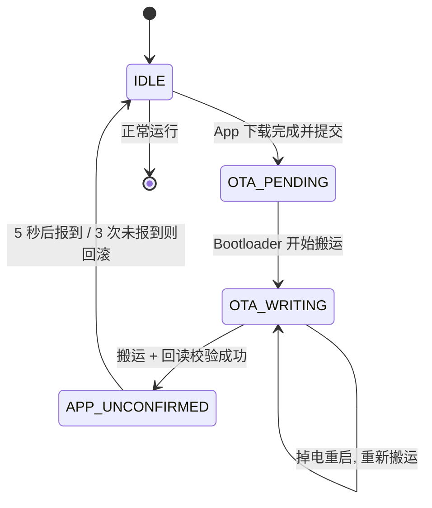
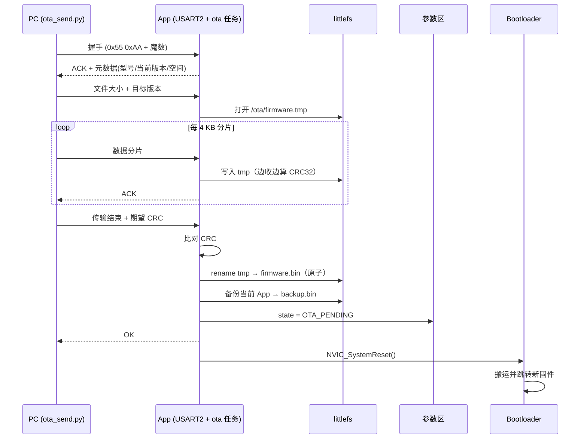
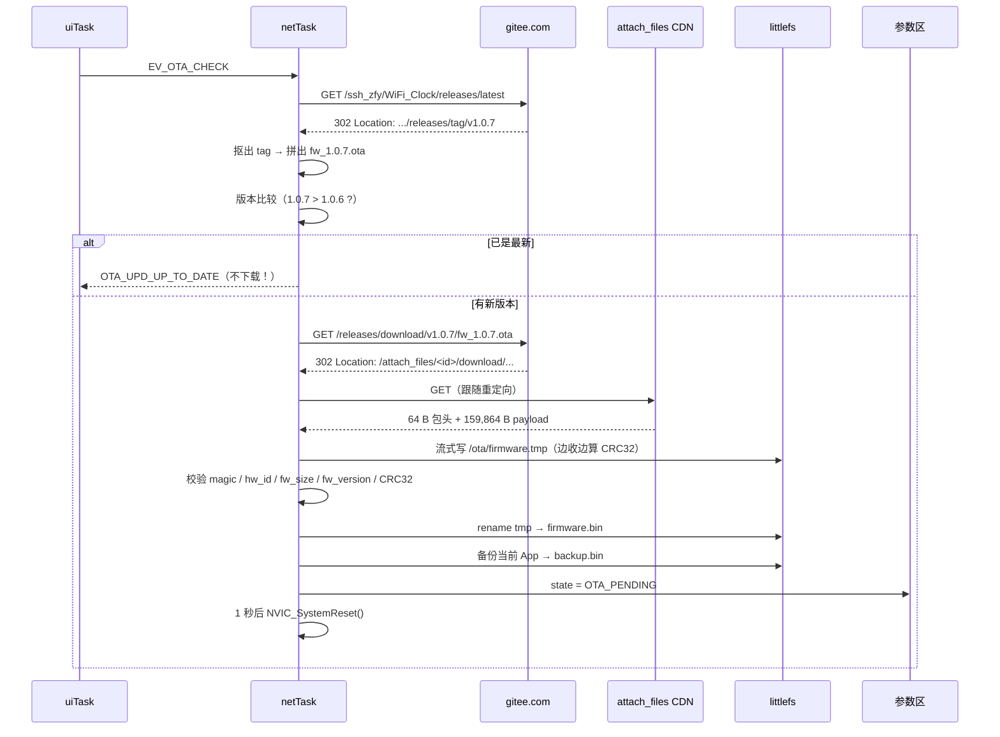
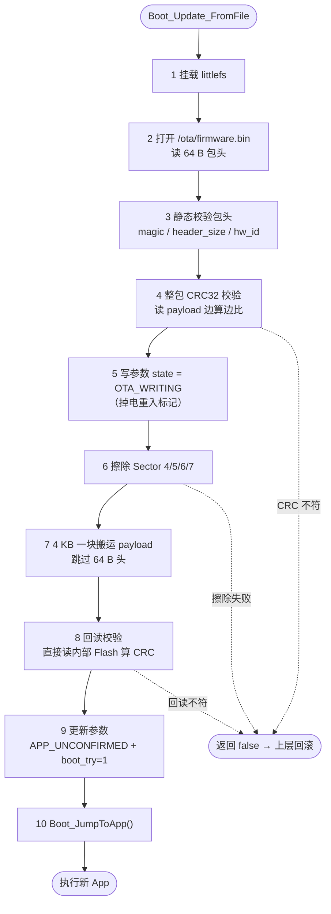
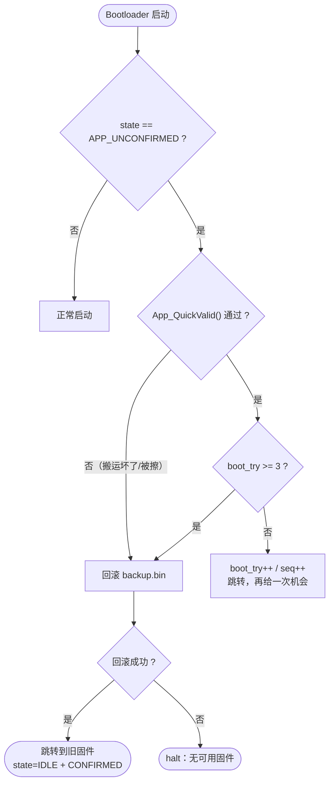

# WiFi_Clock Bootloader 与 OTA 升级全流程（入门版）

> 本文的目标：**第一次接触 Bootloader / OTA 的人，读完能完整复述一次升级是怎么发生的。**
> 对照代码版本：App 1.0.7 / Bootloader 1.0（2026-10-27）。
>
> **三份文档分工**：
> - 本文 = 现状流程（搞清"怎么跑"）——新手从第 1 章开始读
> - 《Bootloader_OTA_Guide.md》 = 原理、设计取舍与踩坑历史（理解"为什么"）
> - 《OTA_Test_Record.md》 = Phase 0/1/2 的测试方法与实测记录（复现"怎么验"）
>
> **图怎么看**：本文用 Mermaid 画流程图。VS Code 装 "Markdown Preview Mermaid Support"
> 插件、或直接用 Typora / GitHub 网页打开即可渲染；纯文本编辑器里会看到 ```mermaid 代码块，
> 内容本身也是可读的文本流程图。

---

## 1. 先花 5 分钟：Bootloader 和 OTA 到底是什么

本章没有技术细节，只建立直觉。后面每一章都会回到这里的类比。

### 1.1 用生活类比理解三个词

把设备想成**一栋只有三间房的楼**：门卫室、住户房、留言板。

- **Bootloader（引导加载器）= 门卫兼装修队**。
  每次上电（开门营业）都是门卫第一个到岗：看一眼留言板，确认住户房没问题，
  就把钥匙交给住户（跳转），自己下班。
  需要翻修住户房（升级固件）时，也只有他有权限动手拆墙、重装。

- **OTA（Over-The-Air，空中升级）= 不拆机、不插线，远程换一套新装修。**
  具体到本项目，就是两条路：PC 用串口发（第 5 章），或者设备联网下载（第 6 章）。

- **固件（Firmware）= 烧在芯片里的程序本身。**
  硬件是"固"定的，程序是"件"，合起来就是"固化在硬件里的软件"。

> 顺带解释名字：**Boot** 是"启动"，Bootloader 就是"负责启动的加载程序"。
> 芯片上电后的第一条指令，永远从它所在的位置开始执行。

### 1.2 为什么固件不能自己升级自己

这是理解整件事的**第一把钥匙**：

> **程序正在 Flash 里运行，而修改 Flash 必须"整块擦除后重写"。**

用类比：一个人站在地板上，却想把地板拆掉重铺——地板一拆，自己先掉下去。
程序也一样：App 正在自己的 Flash 区里取指令执行，它如果动手擦自己脚下的 Flash，
擦到一半代码就没了，芯片当场死掉。

```text
✗ App 自己升级自己：      拆自己脚下的地板 → 人先掉下去
✓ Bootloader 升级 App：  拆 App 的地板，自己站在旁边的房间，安全
```

所以解决办法是**分工**：

```text
App（住户）      → 只负责把新材料运到仓库（下载 .ota 到外部 Flash）
Bootloader（门卫）→ 只负责动手拆装（擦掉旧 App、写入新 App）
```

这也就是为什么需要**两段独立的程序**，而不是一段。

### 1.3 本项目的三个角色

| 角色 | 住址 | 职责 | 类比 |
| --- | --- | --- | --- |
| **Bootloader** | `0x08000000`，48 KB | 决定"跑谁"；把 `.ota` 搬进 App 区 | 门卫 + 装修队 |
| **App** | `0x08010000`，448 KB | 时钟/天气业务；下载 `.ota`；证明自己能跑 | 住户 |
| **参数区** | `0x0800C000`，16 KB | 两者**唯一**的沟通渠道 | 留言板 |

两个关键约定：

- Bootloader **不带网络、不带屏幕、不带操作系统**——它越小越笨越好，
  复杂的活全在 App 里做。
- App **不能修改 Flash 分区**，Bootloader 也不能连网——所以两边必须靠
  "留言板"（参数区）传话：App 写"新货到了"，Bootloader 读了就去干活。

### 1.4 一次升级的完整旅程（全文主线）

后面所有章节，其实都在解释下面这 9 步。**先记住这个流程，再看细节。**

```text
① 用户点屏幕上的 "Check Update" 按钮                    （第 6 章）
② App 问服务器："现在最新版本是几？"                      （第 6 章）
③ 有新版本 → App 边下载边校验，写入外部 Flash            （第 6、9 章）
④ 下载完 → App 把"当前正在跑的自己"复制一份作备份        （第 7 章）
⑤ App 在留言板写："新货已到，请搬运" → 自我重启          （第 4 章）
⑥ 门卫上岗：验货 → 拆掉旧 App → 搬入新 App              （第 7 章）
⑦ 门卫写："新住户已入住，请 5 秒内报到" → 交钥匙          （第 7 章）
⑧ 新 App 跑起来，5 秒后写"我活着" → 升级完成             （第 8 章）
⑨ 若 3 次都没报到 → 门卫把备份搬回来（回滚）             （第 8 章）
```


### 1.5 先认识的 9 个词（后面不再重复解释）

| 词 | 一句话解释 |
| --- | --- |
| Flash | 芯片里"掉电不丢"的存储器。特点是**只能整块擦除后写入**，不能像内存那样原地改一个字节 |
| 扇区（Sector） | Flash **擦除的最小单位**。本芯片有 16K / 64K / 128K 三种大小，不是等分的 |
| 擦除 | 把一块 Flash 全部变成 `0xFF`（空房） |
| 写入 | Flash 只能把 1 写成 0，所以要先擦成 `0xFF` 才能写新内容 |
| CRC | 校验和：对一段数据算出一个数，数据被改坏一丁点，算出的数就对不上 |
| 复位 | 芯片从头开始执行（相当于电脑重启） |
| 向量表 | 芯片启动时查阅的"入口地址清单"，第一项是栈顶、第二项是入口函数 |
| 固件 / `.bin` | 烧进 Flash 的机器码文件，CPU 直接执行 |
| `.ota` | 本项目自定义的升级包格式 = 64 字节"身份证" + 裸 `.bin`（见第 9 章） |

---

## 2. 地图：东西都放在哪里

一句话：**芯片内部 Flash 切成三间房；升级包和备份放在外挂的 8 MB 大仓库里。**

### 2.1 内部 Flash 分区

```text
0x08000000 ┌──────────────────────────────┐
           │  Sector 0-2   Bootloader 48K │  门卫室：永不擦除（只能烧录器改写）
0x0800C000 ├──────────────────────────────┤
           │  Sector 3     参数区   16K   │  留言板：追加式书写，写满才擦
0x08010000 ├──────────────────────────────┤
           │  Sector 4      64K           │
           │  Sector 5     128K           │  住户房：App 448K
           │  Sector 6     128K           │  （OTA 时整段拆掉重装）
           │  Sector 7     128K           │
0x08080000 └──────────────────────────────┘
```

看这张图要记住三件事：

- **为什么门卫室在最低地址**：芯片上电永远从 `0x08000000` 开始执行，
  门卫室必须在这里，住户房往后挪。
- **扇区大小不等**（16K / 64K / 128K）：所以擦除必须用**扇区表**逐个点名，
  不能用 `FLASH_Sector_4 + i` 这种算术循环——`FLASH_Sector_x` 是**位掩码**不是序号，
  曾经因此误触发全片擦除、把门卫室一起拆了（见《Guide》17.1）。
- **留言板单独占一个扇区**：擦留言板时不会误伤 App。
  门卫室实际只用了 13 KB，留白是给以后的 YMODEM 救援、验签准备的。

### 2.2 外部 Flash（W25Q64，8 MB）上的文件

内部 Flash 太挤（512 KB），大文件都放外挂的 W25Q64 里，用 littlefs 文件系统管理。
升级相关的只有四个文件：

| 路径 | 作用 | 谁写 | 谁读 |
| --- | --- | --- | --- |
| `/ota/firmware.tmp` | 下载中的临时文件 | App | — |
| `/ota/firmware.bin` | 下载完成、待搬运的新固件 | App（改名） | Bootloader |
| `/ota/backup.tmp` | 备份中的临时文件 | App | — |
| `/ota/backup.bin` | 当前固件的备份（回滚用） | App（改名） | Bootloader |

**为什么处处是 `tmp` 先写、再 `rename` 改名**：文件系统的"改名"是原子操作——
掉电时要么是旧文件、要么是新文件，**绝不会出现"写了一半的 .bin"**。
门卫打开文件时永远看到完整内容，不用先检查"这文件写完了吗"。

---

## 3. 上电后发生了什么（Bootloader 状态机）

一句话：**每次上电/复位，都是门卫先上班，按留言板决定下一步。**

### 3.1 决策图



### 3.2 留言板上的六种状态

`state` 字段只有 6 个值，各管一件事。**人话版**：

| 状态 | 值 | 人话 | 谁写 |
| --- | --- | --- | --- |
| `IDLE` | 0 | 一切正常，住户已报到 | 门卫（回滚成功后）/ 默认 |
| `OTA_PENDING` | 1 | **新货已到仓库，请门卫搬运** | App（`OTA_CommitFirmware()`） |
| `OTA_WRITING` | 2 | **正在搬运中**（中途停电靠它重来） | 门卫自己 |
| `APP_UNCONFIRMED` | 3 | **新住户入住，还没报到** | 门卫搬完新固件 |
| `ROLLBACK` | 4 | 请把旧住户请回来 | 预留（当前无人写） |
| `RECOVERY` | 5 | 无可用固件，等串口救援 | **未实现**（暂按 IDLE 处理） |

> 状态机全图见 4.3。这里先有个印象：**PENDING 是"请求"，WRITING 是"干到一半"，UNCONFIRMED 是"等验收"。**

### 3.3 快速检查 `App_QuickValid()`：验货只验三眼

正常启动要**几十毫秒**内完成，不能每次都做整包 CRC（那要 0.3 秒起步）。
所以门卫只瞄三眼：

1. 住户房门口贴的**栈顶地址**（`*(uint32_t*)0x08010000`）落在合理的 RAM 范围内；
2. **入口地址**（`*(uint32_t*)0x08010004`）在 App 区内，且 **bit0 = 1**（Thumb 指令标志）；
3. 前 8 个字不能全是 `0xFF`（全是 `0xFF` = 房子是空的，从未装修）。

> 整包 CRC 交给"搬运后的回读校验"（7.4），两者分工：启动时快、搬运时严。

### 3.4 交钥匙的仪式：跳转序列（`Boot_JumpToApp`）

门卫把控制权交给 App 不是简单跳一下，**顺序不能乱**，乱了就会出现各种诡异死机：

```text
关中断 → 关 SysTick → 清 NVIC 使能/挂起 → 关 USART2
       → 设 VTOR = APP_BASE → DSB/ISB
       → __set_MSP(向量表[0]) → 开中断 → 跳到 向量表[1]
```

三个"不这么干会怎样"：

- 不设 **VTOR**（中断向量表指针）→ App 的中断会打到门卫的向量表上，乱套；
- 不设 **MSP**（主栈指针）→ App 继续用门卫的栈，两个程序挤一个栈；
- 最后不开中断 → App 的 SysTick / FreeRTOS 根本起不来。

> 注意：App 侧还要**自己再设一次 VTOR**。因为 `SystemInit()` 里 `VECT_TAB_OFFSET = 0`
> 会把 VTOR 改回 `0x08000000`。所以 `app_task.c` 的 `Boot_Apply_VectorTable()`
> 必须在 App 初始化外设之前执行——两边各设一次，谁都不能省。

### 3.5 一个必须知道的事实

`halt 死循环` 目前是**真的停住**，只能靠 ST-Link 重新烧录恢复。
这是 Phase 3 要改成 YMODEM 串口救援的地方（`BOOT_FLAG_FORCE_RECOVERY` 已定义但未使用）。

---

## 4. 参数区：两者唯一的沟通渠道

一句话：**门卫和住户不见面，全部对话都写在 16 KB 的留言板上。**

### 4.1 留言板长什么样（64 字节一条，尾部带 CRC）

```c
typedef struct {
    uint32_t magic;        // 0x424F4F54 'BOOT' —— 识别"这是我家的留言"
    uint32_t seq;          // 第几页：单调递增，取最大者有效
    uint32_t layout;       // 排版版本
    uint32_t state;        // 见 3.2 的六种状态
    uint32_t app_size;     // 当前 App 有效字节数
    uint32_t app_crc32;    // 当前 App 的 CRC32
    uint32_t app_version;  // major<<16 | minor<<8 | patch
    uint32_t ota_size;     // 待升级固件 payload 大小
    uint32_t ota_crc32;    // 待升级固件 CRC
    uint32_t ota_version;  // 待升级版本
    uint32_t ota_slot;     // 预留
    uint32_t boot_try;     // 新 App 已尝试启动几次
    uint32_t flags;        // BOOT_FLAG_*（见下）
    uint32_t reserved[2];
    uint32_t crc32;        // 前面所有字节的 CRC32，必须在最后
} boot_param_t;
```

四个标志位：

| 宏 | 含义（人话） |
| --- | --- |
| `BOOT_FLAG_CONFIRMED` | 住户已经报过到（"我活着"） |
| `BOOT_FLAG_BACKUP_VALID` | 仓库里的备份可用，可以回滚 |
| `BOOT_FLAG_OTA_VERIFIED` | 待安装固件已通过 CRC 验货 |
| `BOOT_FLAG_FORCE_RECOVERY` | 强制进串口救援（**已定义，未使用**） |

### 4.2 为什么是"账本式追加"，而不是直接覆盖

**不能直接覆盖写**：Flash 写之前必须擦除（200~400 ms 的停电窗口）。
如果"擦掉旧页 → 写新页"之间停电，留言板就全没了。

所以做成**账本**：每次只往下一页写，从不回头改旧页。

```text
槽 0    槽 1    槽 2    槽 3  ...  槽 31     （每槽 64 B，共 32 槽 / 2 KB）
[最新]  [较旧]  [更旧]  [空]       [空]
```

- 写：找第一个全 `0xFF` 的空白槽写入，`seq++`（翻页）。
- 读：扫全部 32 条，校验 magic / layout / crc32，取 `seq` 最大（最新页）的那条。
- 写满 32 条：整本擦掉（16 KB 扇区），从槽 0 重新开始。

停电时最坏情况是"最新那页写了一半"——CRC 校验让它作废，读回的是**上一页完整记录**。
状态最多倒退一步，留言板永远不会整体丢失。

### 4.3 状态流转总图



---

## 5. 升级链路 A：串口离线 OTA

一句话：**开发调试时，用一根 USB 转串口线把升级包喂给设备。**

- 适用场景：开发调试、没有 WiFi、网络升级失败后的兜底。
- 开关：`BuildConfig.h` 的 `OTA_SERIAL_TEST = 1`（会创建 `ota` 任务并占用 USART2）。
- PC 端工具：`Documents/Tools/ota_send.py`。

### 5.1 时序



和网络升级（第 6 章）对比会发现：**从"写入 firmware.tmp"开始，两条路完全重合。**
区别只在"货是怎么运到仓库的"——串口搬运 or 网络下载。

### 5.2 关键约束

- 与 `DEBUG_SUPPORT = 1` **互斥**：两者都占用 USART2（PA2/PA3）。串口 OTA 测试时必须 `DEBUG_SUPPORT = 0`。
- 串口接收用 4 KB 环形缓冲 + DMA，主机可以连续发送，不用等 ACK 逐字节。

---

## 6. 升级链路 B：网络 OTA（当前主用）

一句话：**设备自己联网，去 Gitee 问"最新版本是几"，有新版本就拉回来。**
对应主线叙事的 ①②③步。

- 触发：`ui_WiFi.c` 的 `ui_CheckUpdate` 按钮 → 置位 `EV_OTA_CHECK` → netTask 调用 `OTA_Update_Run()`。
- 代码：`OTA_Update.c`（347 行）+ `OTA_Net.c`（HTTP/SSL 流式客户端）。

### 6.1 时序



### 6.2 版本发现：为什么不能把下载地址写死在代码里

早期实现把地址写死：`.../releases/download/v1.0.6/fw_106_gitee.ota`。
这有个致命问题：

> URL 存在于**正在运行的固件**里。1.0.6 的设备永远只知道 1.0.6 的地址，
> 改源码只影响"将来编译出来的新固件"，对**已经出厂的设备**无效。
> 结果就是设备只能升级一次，之后永远停在旧版本。

解决办法是让设备**自己去问**"现在最新是哪个版本"：

```text
GET https://gitee.com/<owner>/<repo>/releases/latest
  → 302  Location: https://gitee.com/<owner>/<repo>/releases/tag/v1.0.7
                                                              ^^^^^^ 从地址里抠出版本
再拼：https://gitee.com/<owner>/<repo>/releases/download/v1.0.7/fw_1.0.7.ota
```

`Location` 只有 56 字节，几乎零开销。三种候选路径的实测对比：

| 请求 | 响应 | Location 长度 |
| --- | --- | --- |
| `/releases/latest` | 302 → tag 页 | **56 B** ✅ |
| `releases/download/vX.X.X/fw.ota` | 302 → `attach_files/<id>/download/` | 83 B ✅ |
| `/raw/main/...` | 302 → `raw.giteeusercontent.com/...?signature=...` | **400 B** ⚠️ 逼近 512 缓冲，弃用 |

顺带的性能收益：版本比较提前到下载之前——**已是最新时不再下载 160 KB**，
只读一个 302 头，几秒就能判定（旧实现要空跑 45 秒）。

### 6.3 发布约定（零代码改动）

发新版本只做两件事，**不用改任何代码**：

1. 打 tag：`v1.0.8` —— 三段十进制，不带前导零
2. 上传附件：`fw_1.0.8.ota` —— `"fw_" + tag去掉'v' + ".ota"`

两项**必须严格对应**，设备按这条规则拼地址，任何一处不一致都会 404。
发布顺序必须单调递增，不要补发旧版本号（`latest` 会指向较新的那个）。

打包命令：

```bash
py Documents/Tools/ota_pack.py MDK\Output\STM32F407.bin fw_1.0.8.ota --version 1.0.8
```

### 6.4 为什么不用 Gitee API

`/api/v5/repos/.../releases/latest` 匿名访问几次后会 **403 限流**，必须填 token 才稳定。
而 `/releases/latest` 只回一个 302 头，不消耗 API 配额、不用认证。

---

## 7. 搬运核心：Bootloader 怎么把 .ota 写进 Flash

一句话：**门卫的看家本领——验货 → 拆旧 → 装新 → 复验，全程有断电保护。**
对应主线叙事的 ④⑤⑥⑦步。

### 7.1 十步流程（`Update_Run`）



### 7.2 为什么先校验、再擦除（顺序是保命符）

擦除 App 区会**立刻销毁当前可用的固件**。所以顺序必须是：

```text
读包头 → 校验 magic/hw_id → 整包 CRC 校验 → 参数标记 WRITING → 才敢擦
```

如果先擦再校验，碰上坏包就是"旧固件没了、新固件也不能用"，只能拆机。
这条是全文第二条铁律（见 12.4）。

### 7.3 掉电重入：干到一半停电怎么办

擦除到一半掉电会发生什么？

```text
参数区：state = OTA_WRITING（第 5 步就写好了）
App 区：部分擦除，内容损坏
```

下次启动 → 门卫看到 `OTA_WRITING` → **从头重新走完整搬运流程**
（源文件在外部 Flash，完好无损）→ 重新擦除、重新写入。

所以"搬运中途掉电"是安全的，代价只是重来一遍。**先留标记、再动手**
（第 5 步在擦除之前），正是为了这一刻。

### 7.4 回读校验：装完还要复验

写完立刻读回内部 Flash 算 CRC，和包头里的 `fw_crc32` 比对。
这一步能抓到"写入过程出现位错误"——虽然少见，但 Flash 写坏的代价是变砖：
新 App 校验不过 → 回滚；回滚也坏 → halt。

### 7.5 搬运完成后的参数（门卫写的交接单）

```c
p.state       = BOOT_ST_APP_UNCONFIRMED;  // 新 App 待确认
p.app_size    = hdr.fw_size;
p.app_crc32   = hdr.fw_crc32;
p.app_version = hdr.fw_version;
p.boot_try    = 1;                        // 这是第 1 次运行
p.flags       = BACKUP_VALID | OTA_VERIFIED;
```

注意 `app_size` 在这里被写成**精确值**（等于 `.bin` 实际长度）。App 之后备份自己时，
如果参数区是 `APP_UNCONFIRMED` 就采信这个值，否则用 `APP_FW_SIZE_FALLBACK`（160 KB）。

> 为什么有这条规则：ST-Link 直接烧录时参数区里是**上一次**的 `app_size`，可能比当前固件小。
> 采信它会备份截断，找回滚时 `.data` 段丢失 → 黑屏。这是 Phase 1 踩过的坑。

---

## 8. 回滚机制：装坏了自动退回

一句话：**新住户 3 次报到失败，门卫就把老住户请回来。**
对应主线叙事的 ⑧⑨步。

### 8.1 两个变量

- `BOOT_FLAG_CONFIRMED`：App 承认"我能跑"（报到成功）
- `boot_try`：新 App 已经被尝试启动了几次

### 8.2 正常路径（报到成功）

```text
Bootloader 搬完 → state=APP_UNCONFIRMED, boot_try=1 → 跳转
      ↓
App 启动 → FreeRTOS 跑起来 → Boot_Confirm_Task 延迟 5 秒
      ↓
5 秒后仍然活着 → SetAppInfo(size, crc, APP_VERSION) + Confirm()
      ↓
state=IDLE, flags|=CONFIRMED
```

**为什么延迟 5 秒**：过滤"启动就崩溃"的情况。如果 App 在 5 秒内挂掉
（HardFault、栈溢出、死循环），确认任务根本跑不到，参数区保持 `APP_UNCONFIRMED`。

### 8.3 失败路径（报到失败 → 回滚）



**为什么是 3 次**：给"偶发失败"（比如第一次启动时外设初始化时序问题）留一点余地，
又不至于无限重启。3 次刚好覆盖"连续失败 = 确实坏了"。

### 8.4 回滚成功后的状态

`Boot_Rollback_FromFile` 用的是同一套 `Update_Run`，但参数不同：

```c
Update_Run(path, BOOT_ST_IDLE,
           BOOT_FLAG_BACKUP_VALID | BOOT_FLAG_CONFIRMED);
```

即 `state=IDLE`、`boot_try=0`、直接带 `CONFIRMED`。

**为什么直接标已确认**：备份是"上一个已经跑通过的版本"，没必要再走一遍 5 秒确认。
否则每次回滚还要多等 5 秒×3 次。

### 8.5 掉电矩阵：每个时刻停电，重启后会怎样

| 掉电时刻 | 参数区状态 | 重启后行为 |
| --- | --- | --- |
| 下载中 | 未变 | 临时文件残留，下次下载会先删掉重来 |
| rename 之前 | 未变 | 同上 |
| 备份中 | 未变 | `backup.tmp` 残留，旧 `backup.bin` 仍在 |
| 写 `OTA_PENDING` 之后 | `OTA_PENDING` | 重新搬运 |
| 擦除/写入 App 中 | `OTA_WRITING` | 重新搬运（源文件完好） |
| 搬运完成、跳转前 | `APP_UNCONFIRMED` | 按未确认处理，3 次后回滚 |
| 确认任务执行前 | `APP_UNCONFIRMED` | 再给一次机会（boot_try++） |
| 确认任务执行后 | `IDLE` | 正常运行 |

**这张表的意义：整个升级链路中不存在"停电一次就变砖"的时刻。**
最坏情况是回到上一个版本，或者重新搬运一次。

---

## 9. .ota 包格式：升级包的"身份证 + 内容"

一句话：**64 字节身份证（版本、大小、CRC、机型）+ 裸 `.bin` 程序。**

| 偏移 | 长度 | 字段 | 说明 |
| --- | --- | --- | --- |
| +0x00 | 4 | `magic` | `0x4F544131` = `'OTA1'`，识别"这是升级包" |
| +0x04 | 2 | `header_size` | 固定 64 |
| +0x06 | 2 | `header_crc16` | 头部前 60 B 的 CRC16-CCITT |
| +0x08 | 4 | `fw_version` | `major<<16 \| minor<<8 \| patch`，如 1.0.7 = `0x010007` |
| +0x0C | 4 | `fw_size` | payload 字节数（4 字节对齐） |
| +0x10 | 4 | `fw_crc32` | payload 的 CRC32（zlib 标准反射） |
| +0x14 | 4 | `hw_id` | `0x04074001`，防止把别的机型的固件刷进来 |
| +0x18 | 4 | `build_time` | Unix 时间戳（诊断用） |
| +0x1C | 4 | `flags` | 保留 |
| +0x20 | 4 | `min_boot_ver` | 最低 Bootloader 版本（预留） |
| +0x24 | 28 | `reserved` | 预留签名等 |
| +0x40 | N | payload | 裸 App `.bin` |

三条设计要点：

1. **为什么要包头**：版本号、CRC、`hw_id` 必须和固件绑在一起传输，
   否则无法判断"要不要装"和"装得对不对"。
2. **为什么 payload 要 4 字节对齐**：Bootloader 用 `FLASH_ProgramWord` 逐 4 字节写，
   长度不是 4 的倍数时最后一次写入会越界。打包工具补 `0xFF` 到 4 的倍数。
3. **为什么 CRC 只覆盖 payload**：头部有独立的 `header_crc16`；分开算才能
   "边下载边算 CRC"（跳过前 64 B 即可），不用把整个文件缓存下来。

---

## 10. 代码地图

想读代码时，按这张表找入口。

### 10.1 Bootloader

| 文件 | 职责 | 关键函数 |
| --- | --- | --- |
| [`Boot/Src/boot_main.c`](../Boot/Src/boot_main.c) | 入口、状态机、跳转 | `main()`、`App_QuickValid()`、`Boot_JumpToApp()` |
| [`Boot/Src/boot_update.c`](../Boot/Src/boot_update.c) | 搬运核心（校验/擦除/写入/回读） | `Update_Run()`、`Boot_Update_FromFile()`、`Boot_Rollback_FromFile()` |
| [`Boot/Src/boot_param.c`](../Boot/Src/boot_param.c) | 参数区账本式读写 | `Boot_Param_Load/Save/Confirm/SetAppInfo()` |
| [`Boot/Src/boot_lfs.c`](../Boot/Src/boot_lfs.c) | 只读挂载 W25Q64 | `Boot_Lfs_Mount()`、`Boot_Lfs_FileOpen()` |
| [`Boot/Src/boot_crc32.c`](../Boot/Src/boot_crc32.c) | 标准 CRC32（与 PC 的 zlib 一致） | `Boot_CRC32()`、`Boot_CRC32_Update()` |
| [`Boot/Src/boot_uart.c`](../Boot/Src/boot_uart.c) | 纯轮询串口日志（USART2） | `Boot_Uart_Puts/PutU32/PutHex()` |
| [`Boot/Inc/boot_layout.h`](../Boot/Inc/boot_layout.h) | 分区地址与文件路径 | — |
| [`Boot/Inc/boot_param.h`](../Boot/Inc/boot_param.h) | 参数结构、状态、标志 | — |
| [`Boot/Inc/ota_pkg.h`](../Boot/Inc/ota_pkg.h) | `.ota` 包头格式 | — |

### 10.2 App

| 文件 | 职责 | 关键函数 |
| --- | --- | --- |
| [`User/Application/Src/OTA.c`](../User/Application/Src/OTA.c) | 串口 OTA 会话、备份、提交 | `OTA_Run()`、`OTA_CommitFirmware()`、`OTA_AppSelfSize()`、`OTA_CalcAppInfo()` |
| [`User/Application/Src/OTA_Update.c`](../User/Application/Src/OTA_Update.c) | 网络升级主流程 | `OTA_Update_Run()`、`OTA_ParseTag()`、`OTA_BuildAssetUrl()`、`Dl_Sink()` |
| [`BSP/Src/OTA_Net.c`](../BSP/Src/OTA_Net.c) | HTTP/SSL 流式客户端（基于 ESP-AT） | `OTA_Net_HttpGet()`、`OTA_Net_HttpGetUrl()` |
| [`BSP/Src/OTA_Store.c`](../BSP/Src/OTA_Store.c) | littlefs 读写封装 | `OTA_Store_OpenWrite/Write/Close/Rename/Remove/FreeBytes()` |
| [`User/Application/Src/app_task.c`](../User/Application/Src/app_task.c) | VTOR 修正、启动确认任务 | `Boot_Confirm_Task()`、`App_Task_Init()` |
| [`User/Task/Src/Net_Task.c`](../User/Task/Src/Net_Task.c) | 网络任务，处理 `EV_OTA_CHECK` | `OTA_Update_Run()` 的调用点 |
| [`User/UI/Src/OTA_UI.c`](../User/UI/Src/OTA_UI.c) | 升级进度浮层（LVGL） | `OTA_UI_Init()`、`OTA_UI_Tick()` |
| [`User/UI/Src/screens/ui_WiFi.c`](../User/UI/Src/screens/ui_WiFi.c) | "Check Update" 按钮 | 置位 `EV_OTA_CHECK` |
| [`User/Application/Inc/BuildConfig.h`](../User/Application/Inc/BuildConfig.h) | 编译开关、Gitee 仓库配置 | — |
| [`User/Application/Inc/Version.h`](../User/Application/Inc/Version.h) | 唯一版本源 | `APP_VERSION`、`APP_VERSION_STR` |

### 10.3 工具

| 文件 | 用途 |
| --- | --- |
| [`Documents/Tools/ota_pack.py`](Tools/ota_pack.py) | 把 `.bin` 打成 `.ota` |
| [`Documents/Tools/ota_send.py`](Tools/ota_send.py) | PC 端串口 OTA 发送 |
| [`Documents/Tools/test_tag_parse.py`](Tools/test_tag_parse.py) | 离线回归：tag 解析 / 版本比较 / 拼 URL |

---

## 11. 故障与恢复

| 现象 | 原因 | 怎么救 |
| --- | --- | --- |
| 串口只有 `[BOOT] app invalid, halt` | App 区被擦空或从未烧录 | ST-Link 烧 App |
| `[BOOT] update failed` → `[BOOT] no usable firmware, halt` | 新固件坏 + 备份也坏 | ST-Link 烧 App |
| `[BOOT] rollback failed, halt` | `backup.bin` 损坏或不存在 | ST-Link 烧 App |
| 开机跑一下就回滚 | 新 App 5 秒内崩溃，`boot_try` 到 3 | 查 App 崩溃原因，修好后重发 |
| 点 Check Update 显示 `No latest tag` | `releases/latest` 没返回 302 | 检查仓库是否公开、是否有 Release |
| 下载 404 | 附件名与 tag 不匹配 | 按 `fw_<ver>.ota` 命名重新上传 |
| 下载后 `bad hdr` | 包内版本与 tag 不一致 | 用对应版本的包，不要混用 |
| 一直提示"已是最新" | 当前版本 >= 最新 tag | 正常行为 |
| 屏幕黑屏但能启动 | 备份时 `app_size` 采信了旧值导致截断 | 确认参数区状态与 `APP_FW_SIZE_FALLBACK` |

> 目前所有 `halt` 都只能靠 ST-Link 恢复。Phase 3 计划把这三处改成 YMODEM 串口救援。

---

## 12. 速查表

### 12.1 地址

| 项 | 值 |
| --- | --- |
| Bootloader | `0x08000000`，48 KB |
| 参数区 | `0x0800C000`，16 KB，32 槽 × 64 B |
| App | `0x08010000`，448 KB |
| `.ota` 头 | 64 B |
| 搬运缓冲 | 4 KB |
| 串口 | USART2（PA2/PA3），115200-8N1 |
| WiFi 模组 | USART1（PA9/PA10），115200 |

### 12.2 版本号编码

```text
APP_VERSION = major<<16 | minor<<8 | patch
1.0.7  →  0x00010007
```

三处必须同步：`Version.h`、`ota_pack.py --version`、Gitee tag。

### 12.3 一次升级的完整动作序列

```text
[用户点按钮]
  → 读 /releases/latest 拿 tag            （约 3~5 s）
  → 版本比较                              （本地，瞬时）
  → 下载 .ota 到 firmware.tmp             （约 25~45 s，视网络）
  → 校验包头 + payload CRC                （约 0.5 s）
  → rename 为 firmware.bin                （瞬时，原子）
  → 备份当前 App 到 backup.bin            （约 2~3 s）
  → 写参数 state = OTA_PENDING            （瞬时）
  → 延时 1 s + 复位
[重启]
  → Bootloader 读包头 + 整包 CRC          （约 0.5 s）
  → 标记 OTA_WRITING
  → 擦除 Sector 4/5/6/7                   （约 2~4 s）
  → 搬运 156 KB                           （约 1~2 s）
  → 回读校验                              （约 0.3 s）
  → 写参数 APP_UNCONFIRMED + boot_try=1
  → 跳转
[App 启动]
  → 5 s 后写 CONFIRMED                    （完成）
```

### 12.4 三个"绝不能破"的规则

1. **先校验、后擦除**——顺序反了就是变砖。
2. **参数状态先写、动作后做**——先标 `OTA_WRITING` 再擦除，才能掉电重入。
3. **文件一律 tmp + rename**——否则 Bootloader 可能读到半截文件。

### 12.5 如果只记住三句话

1. **上电先跑 Bootloader，它看参数区决定"跑谁、要不要搬"**（第 3、4 章）。
2. **App 负责运货（下载 + 备份 + 留言），Bootloader 负责拆装（校验 + 擦除 + 写入）**（第 6、7 章）。
3. **新固件 5 秒内报到成功才算升级成功，3 次失败自动回滚**（第 8 章）。
